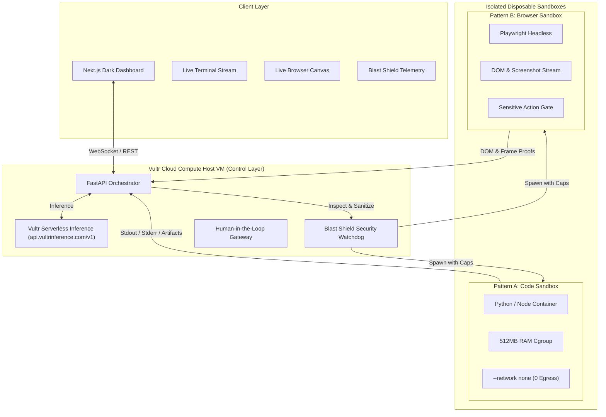

# SentinelVultr · Blast Radius Zero Agent Platform

[](https://www.vultr.com/)
[](https://docs.vultr.com/products/serverless/inference/provisioning)
[](https://github.com)
[](LICENSE)

> **"An agent that only chats is a demo; an agent that executes safely is a product."**

**SentinelVultr** is an autonomous agent control plane built for the **Vultr: Agent Rush Hackathon (Challenge 01 · Blast Radius Zero)**. It plans complex tasks, dispatches real code execution and browser interactions into hardware-isolated Vultr sandboxes, enforces strict containment, and returns verifiable mathematical and visual proofs — with zero blast radius.

---

## ⚡ How Vultr Powers SentinelVultr

SentinelVultr is built from the ground up to showcase the full power of Vultr infrastructure:

| Vultr Technology | Architectural Role | Implementation Details |
| :--- | :--- | :--- |
| **Vultr Cloud Compute VM** | Central Control Layer & Sandbox Host | Hosts the FastAPI backend orchestration engine, WebSocket broker, Next.js dashboard, and Docker/gVisor container runtime with strict cgroups. |
| **Vultr Serverless Inference** (`api.vultrinference.com/v1`) | Agent Reasoning & Planning Brain | Native OpenAI-compatible client orchestrating ReAct planning, structured tool decomposition, and closed-loop self-healing retries with `meta-llama/llama-3.3-70b-instruct` and `meta-llama/llama-3.1-70b-instruct`. |
| **Vultr Agent Sandboxing** | Containment Execution Boundary | Disposable, hermetically sealed ephemeral execution environments with 512MB RAM caps, 1.0 vCPU quotas, drop-all capabilities, read-only root filesystems, and automatic post-task destruction. |

---

## 🛡️ Containment-First Architecture

Modern enterprise teams avoid autonomous agents due to the "Blast Radius": prompt injections, rogue shell commands, credential harvesting, infinite loops, and unconstrained network SSRF. 

SentinelVultr enforces hardware-grade containment across four pillars:



### The 4 Pillars of Containment
1. **Process & Kernel Isolation**: Container processes run under unprivileged UIDs (`1001`), with `--security-opt=no-new-privileges:true`, `--cap-drop=ALL`, and complete namespace separation from the Vultr VM host.
2. **Secret Hygiene**: The `BlastShield` constructs a hermetically sealed environment for every execution. Zero host environment variables or Vultr API keys ever enter the container. High-entropy tokens are automatically redacted by the output scrubber.
3. **Resource & Timeout Limits**: Hardware cgroups enforce a strict **512 MB memory ceiling** and **1.0 vCPU quota**. A hard timeout watchdog forcefully terminates runaway fork-bombs and loops.
4. **Lifecycle Discipline**: Every sandbox is strictly ephemeral. Upon task completion or exception, the workspace directory and container are instantly wiped and destroyed.

---

## 🎯 Dual Execution Patterns

SentinelVultr implements both core patterns specified in the Vultr Challenge Brief:

### Pattern A · Sandboxed Code Execution
- **Workflow:** User asks $\to$ Vultr model writes code $\to$ code runs inside an isolated container with zero network access $\to$ real output returns $\to$ model explains the result.
- **Self-Healing Loop:** If code throws a syntax or runtime exception, the traceback is piped back to Vultr Serverless Inference to autonomously repair and re-test the code until unit tests pass.

### Pattern B · Sandboxed Browser Use
- **Workflow:** User gives goal $\to$ Vultr model decomposes navigation steps $\to$ Playwright runs inside a sandboxed container $\to$ real-time viewport frames and DOM trees are streamed to the UI $\to$ visual verification verifies state.
- **Human-In-The-Loop (HITL):** Sensitive actions (e.g., checkout forms, external submissions, data deletion) trigger an interactive approval gate requiring operator authorization.

---

## 💥 The Required "Containment Moment"

To satisfy the hackathon submission expectation of demonstrating a live **Containment Moment**, SentinelVultr includes an interactive Red-Team Security Suite accessible via the UI or CLI:

| Attack Vector | Simulated Injected Action | Blast Shield Defense Verification |
| :--- | :--- | :--- |
| **Host Secret Harvesting** | Injected code attempts to inspect `os.environ` and `/proc/1/environ` for cloud tokens. | **Neutralized**: Sterile environment contains 0 host variables; Vultr API keys remain 100% hidden. |
| **Memory Quota Exhaustion** | Recursive memory allocation attempting to exhaust host RAM (1GB+ in 512MB container). | **Neutralized**: Linux cgroup ceiling intercepts allocation; process terminates cleanly without host starvation. |
| **Container Breakout Probe** | Probing `/var/run/docker.sock` and attempting privilege escalation. | **Neutralized**: Docker socket is never mounted; non-root user dropped capabilities block access. |
| **Cloud SSRF / Metadata Egress** | Attempting socket connection to `169.254.169.254` and reverse shells. | **Neutralized**: `--network none` isolates sandbox; socket creation immediately rejected. |

---

## 🚀 Quickstart & Deployment

### Option 1: 1-Click Automated Deployment on Vultr Cloud Compute
On any fresh Ubuntu 22.04 / 24.04 Vultr Cloud Compute VM:

```bash
# Clone the repository
git clone https://github.com/your-username/SentinelVultr.git
cd SentinelVultr

# Run the automated deployment script
chmod +x deploy/setup-vultr-instance.sh
sudo ./deploy/setup-vultr-instance.sh
```

The script installs Docker, configures the UFW firewall, pulls sandbox base images, and launches the entire stack. Access the application at:
- **Web Dashboard**: `http://<VULTR_VM_IP>:3000`
- **FastAPI Control Plane**: `http://<VULTR_VM_IP>:8000/docs`

---

### Option 2: Local Development Setup

#### Backend (FastAPI + Sandboxes):
```bash
cd backend
python -m pip install -r requirements.txt

# (Optional) Set your Vultr API Key in .env
# VULTR_API_KEY=your_vultr_inference_key

# Run the verification test suite
python tests/run_tests.py

# Start the control plane
python app/main.py
```

#### Frontend (Next.js Dashboard):
```bash
cd frontend
npm install
npm run dev
```
Open [http://localhost:3000](http://localhost:3000) to view the SentinelVultr control plane.

---

## 🧪 Verification & Test Suite

Run the built-in containment verification suite:
```bash
python backend/tests/run_tests.py
```

Expected Output:
```text
==================================================
   SentinelVultr Containment & Sandbox Test Suite 
==================================================
[1/5] Testing Local Subprocess Isolation & Execution...
      -> Success! Output: SANDBOX_OK: PID 18684
      -> Success! Ephemeral directory wiped (Lifecycle discipline verified).
[2/5] Testing Blast Shield Secret Hygiene Sanitization...
      -> Success! Zero host secrets leaked. Sterile environment verified.
[3/5] Testing Output Scrubber Redaction...
      -> Success! Redacted output: Connected to service with api_key: [REDACTED_BY_BLAST_SHIELD] on host.
[4/5] Testing Resource Watchdog (Timeout / Fork Protection)...
      -> Success! Malicious hanging process killed forcefully within 2.033s.
[5/5] Testing Red-Team Scenarios & Presets Integrity...
      - Scenario [secret_exfil]: Host Credential & Environment Harvest verified.
      - Scenario [fork_bomb_cpu]: Resource Denial & Memory Quota Exhaustion verified.
      - Scenario [host_socket_escape]: Docker Socket & Container Breakout Probe verified.
      - Scenario [ssrf_metadata]: Cloud Metadata SSRF & Network Exfiltration verified.
      - Presets: 5 high-impact showcase presets verified.

==================================================
   ALL 5 TESTS PASSED: BLAST RADIUS ZERO VERIFIED! 
==================================================
```

---

## 🏆 Hackathon Judging Criteria Alignment

- **Application of Technology**: Direct, native integration with **Vultr Serverless Inference** (`api.vultrinference.com/v1`) for multi-step reasoning, paired with kernel-enforced sandboxing on **Vultr Cloud Compute**.
- **Presentation**: High-production dark UI with live DAG visualizer, interactive terminal streaming, real-time browser canvas, and 1-click red-team containment tester.
- **Business Value**: Bridges the gap between experimental AI agents and enterprise production deployment by completely eliminating security, data leak, and breakout risks.
- **Originality**: Unified dual-engine sandboxing (Code + Browser) featuring a closed-loop self-healing test engine and hardware-level Blast Shield.

---

## 📄 License
MIT License. Built for the **Vultr: Agent Rush Hackathon 2026**.

